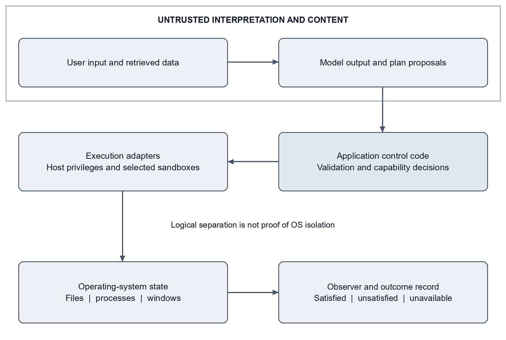
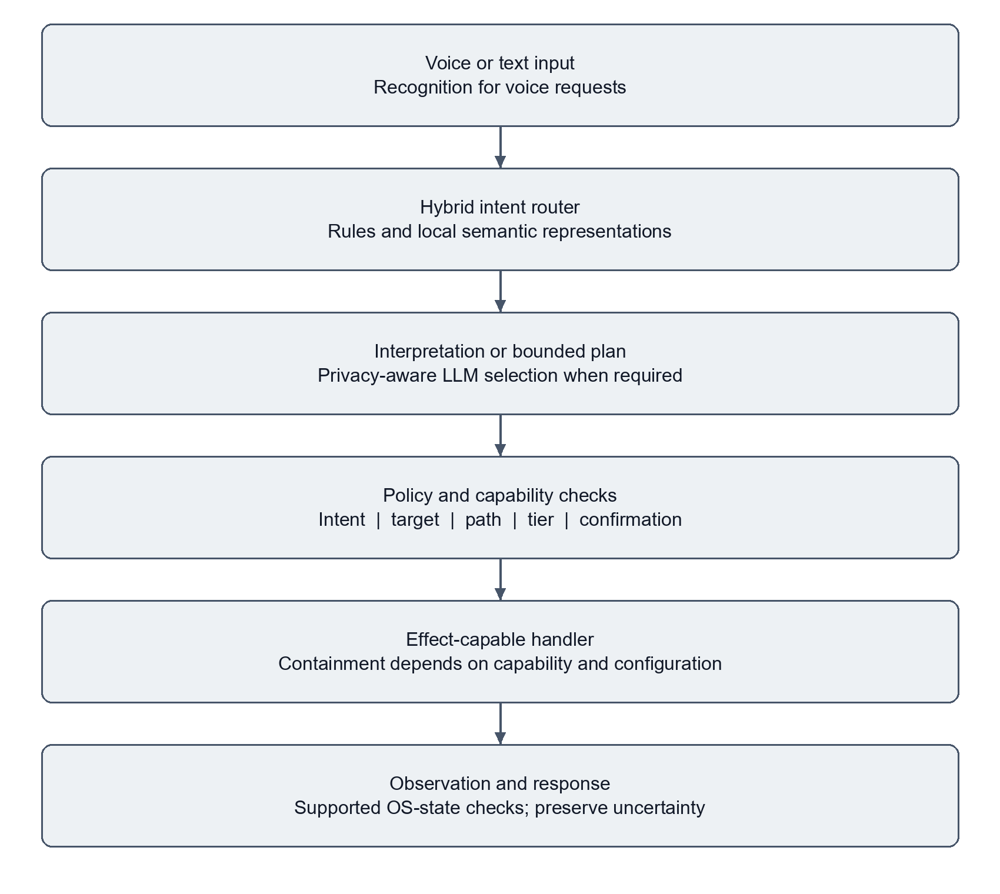
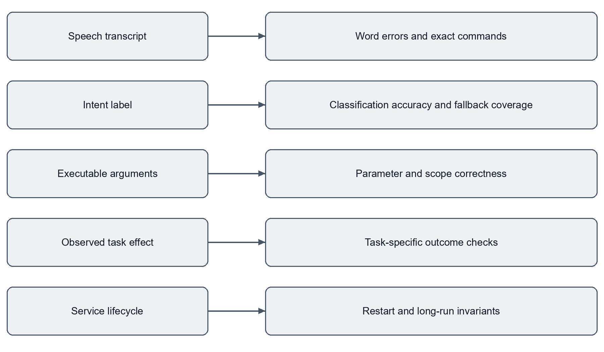
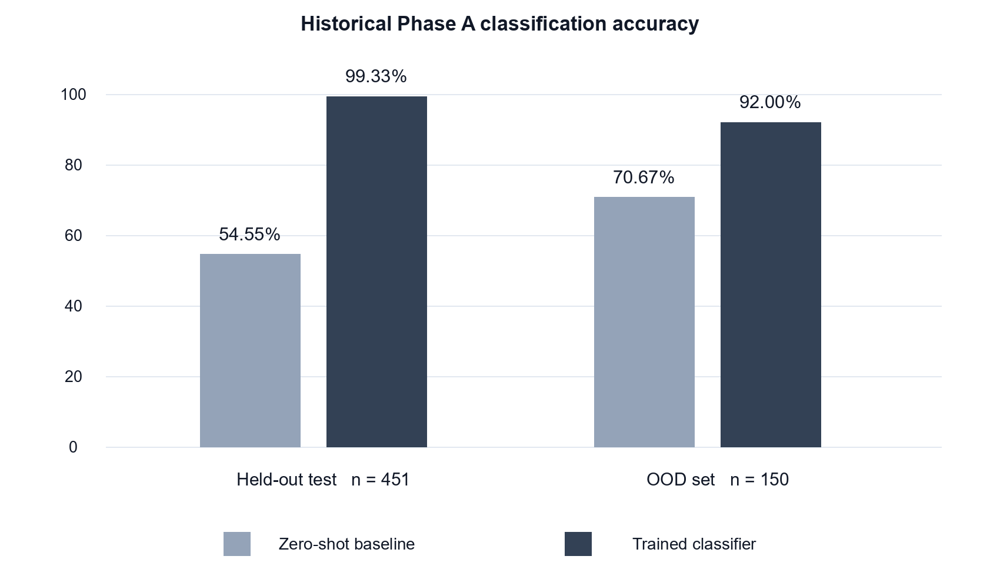

# SentinAL

## A Secure Privacy Routing Voice Agent for Desktop Operating Systems

**Pavan Kumar Gannoju**

Revised BTech final year project thesis. Revision date 5 November 2026.

[Read the PDF](Gannoju_PavanKumar_SentinAL_Thesis.pdf) · [Download the Word document](Gannoju_PavanKumar_SentinAL_Thesis.docx) · [Evidence inventory](Evidence_inventory.json)

# Abstract

Large language models enable natural-language interaction with desktop operating systems, but their integration with privileged tools creates risks involving unauthorized execution, sensitive-data disclosure, and misleading success reports. This thesis investigates how a supervised desktop agent can combine probabilistic interpretation with explicit execution controls and observable task outcomes.

SentinAL is a Windows voice and text agent built around hybrid intent routing, privacy-aware model selection, and a constrained execution pipeline. Deterministic rules and local sentence representations handle supported requests; uncertain interpretations can be deferred to a language model. Proposed steps are checked against intent and target restrictions and assigned capability risk tiers. Where an action has a supported durable postcondition, the system inspects operating-system state after execution. Dependency-aware plans and bounded replanning extend the pipeline to selected multi-step goals.

A recorded classifier evaluation reports 462 correct predictions from 485 held-out examples, or 95.26%, and 159 from 190 separately authored out-of-distribution examples, or 83.68%. On the held-out split, 429 requests, or 88.45%, were resolved without fallback LLM invocation. A historical desktop benchmark records 116 successful attempts from 120 executions of 40 tasks repeated three times. All four failures concerned multi-step tasks. Published CI on 6 October 2026 recorded 1,333 passing tests, two skipped tests, and 86.75% coverage. These measurements concern different system versions and evaluation procedures and are not combined into a single reliability claim.

The principal contribution is an implemented architecture and evaluation method that distinguish interpretation, authorization, execution, and observation. The evidence supports a supervised research prototype within the evaluated scope. It does not establish complete host isolation, universal prompt-injection resistance, comprehensive privacy protection, or unattended reliability. Later local voice and reviewed-learning work is documented separately from published results, together with unresolved approval, execution-boundary, observation, and release-engineering limitations.

Keywords: desktop agents; natural language understanding; intent routing; execution control; postcondition verification; privacy-aware inference; Windows automation.

# Contribution and scope

This document is a revised technical account of the SentinAL BTech final-year project. The original thesis and subsequent development records are retained as historical material. The revision incorporates later implementation and evidence available on 5 November 2026. The revision date distinguishes subsequent development from the original degree-project record.

I led the four-member project team. My principal responsibility was the execution-control component: deciding whether proposed actions could proceed, implementing deterministic routing and path-related controls, and checking supported action effects against operating-system state. System-level results are attributed to the project. The contribution statement distinguishes individual responsibility from system-level evaluation.

Three evidence scopes are maintained throughout. Historical experiments are results associated with earlier datasets and artifacts. Published implementation refers to the public repository and its dated CI records. Local development refers to later modified or untracked source and its recorded tests. A recorded successful run establishes a result for that checkpoint; it does not establish that a different current working tree passes the same tests. No fresh desktop benchmark, microphone study, or long-duration soak was performed to prepare this revision.

# 1 Introduction

## 1.1 Problem statement

A desktop assistant translates a human goal into changes in an operating system. A request such as opening an application appears simple, yet successful execution requires several distinct decisions. The system must identify the intended operation, resolve an executable or resource, determine whether the operation is permitted, carry it out in the correct interactive session, and establish whether the requested effect occurred. Failure at any stage can produce an answer that sounds successful while the machine remains unchanged.

Language models provide a flexible interface for interpreting requests, including unfamiliar phrasing and composite instructions. Their output is nevertheless a proposal. A syntactically valid step can target the wrong resource; a confidently predicted intent can be incorrect; and a successful function return can conceal a failed action. When model output reaches shell execution, an interpretation error can acquire the privileges of the user account running the application.

The central systems problem is therefore the relationship between interpretation and authority. SentinAL studies a design in which language understanding is one stage of a larger pipeline. Policy checks, capability classification, confirmation mechanisms, and observation are implemented outside the model. The design reduces dependence on generative inference for routine requests while making execution outcomes inspectable. The implementation still contains important boundary gaps, which are treated as findings rather than omitted from the account.

## 1.2 Research questions

RQ1 asks whether local routing can identify supported requests accurately and reduce fallback LLM invocation. The evaluation distinguishes classification accuracy from fast-path coverage, since a confidently wrong classification can avoid the LLM without helping the user.

RQ2 asks how sensitive-text detection can influence model selection, and what privacy boundary such routing actually provides. The question includes upstream speech processing and downstream logs because keeping one LLM request local is not equivalent to keeping an entire interaction local.

RQ3 asks how validation, capability controls, and postcondition observation constrain execution and expose false success. Adversarial tests and real task outcomes provide complementary evidence. Neither alone is a proof of security.

RQ4 asks which limitations prevent a supervised prototype from becoming a durable desktop service. Later review evidence is used to examine approval semantics, shell execution, unavailable observations, lifecycle management, and release reproducibility.

## 1.3 Contributions

The first contribution is a hybrid routing implementation that combines deterministic handling, frozen sentence embeddings, a lightweight classifier when its artifact is available, and an uncertainty-driven fallback. Its evaluation explicitly separates predictions, deferrals, and supported-label coverage.

The second contribution is an execution-control architecture combining intent and target restrictions, path checks, capability tiers, and confirmation integration. The implementation demonstrates how these controls can be organized around proposed actions, while its remaining gaps identify why application-level filters must not be described as complete host containment.

The third contribution is an observation-oriented evaluation method. Selected task outcomes are determined from process, filesystem, window, or application state rather than a generated response. The historical benchmark preserves failures, repeated attempts, and a case of false success, allowing the evaluation to reveal weaknesses hidden by return-value-based scoring.

The fourth contribution is a reconciled account of the system's evolution. Historical thesis results, later classifier artifacts, published CI, and unpublished voice and learning checkpoints are preserved with their denominators and limits. This makes the results suitable for inspection without treating different experiments as one controlled progression.

## 1.4 Scope and organization

The target environment is a supervised, single-user Windows desktop. Cross-platform execution, multi-tenant hosting, certified isolation, guaranteed data sovereignty, and unattended operation are outside the established result. The intended academic contribution is an engineering case study with measured components, not a claim to solve general computer use.

Chapter 2 establishes the technical background. Chapter 3 defines requirements and threats. Chapters 4 and 5 describe architecture and implementation. Chapter 6 specifies evaluation methods, Chapter 7 presents results, and Chapter 8 examines their validity. Chapter 9 discusses reproducibility and release limitations. Chapter 10 concludes with ordered future work. Appendices provide evidence identifiers, execution contracts, and a reproducibility checklist.

# 2 Background and related work

## 2.1 Language models as tool users

ReAct interleaves reasoning traces with actions and environmental observations [1]. It motivates a useful distinction between an agent's internal interpretation and its interaction with the outside world. For desktop operation, the authority and side effects of each tool call require additional control. SentinAL uses explicit routing and execution stages; citing ReAct does not establish that the project contains a complete reproduction or a controlled comparison against it.

The design space includes agents that select from typed tools, generate application actions, or interact through screenshots and input events. A more flexible action representation can support more goals, but it also increases the number of effects a validator must reason about. SentinAL's supported intent vocabulary deliberately narrows the problem. Its generalized shell and code-generation paths are exceptions that weaken that narrowing and require separate scrutiny.

## 2.2 Sentence embeddings and classification

Sentence-BERT introduced sentence representations that support efficient semantic similarity comparisons [2]. SentinAL uses the all-MiniLM-L6-v2 family of frozen embeddings as a representation layer. Zero-shot routing compares a request with authored examples; the classifier variant fits a logistic-regression head over embeddings. The pretrained encoder remains a model even when no generative LLM is called.

A classifier only predicts labels represented in its training objective. Adding an intent to an execution registry does not automatically teach the classifier to recognize it. The routing layer therefore needs both a confidence policy and a coverage policy. A prediction margin can indicate uncertainty among known labels, but cannot reliably detect every request belonging to an unseen label.

## 2.3 External language data

MASSIVE is a multilingual natural-language-understanding dataset that includes intent and slot annotations [3]. SentinAL's real-world phrasing evaluation uses a mapped subset of that resource. The mapping changes the label space and the evaluation question. A reported score on the subset is not a score on all MASSIVE languages, intents, or slot-filling tasks.

Synthetic examples provide inexpensive coverage of application-specific operations. Their weakness is shared authorship: training and test prompts may contain the same stylistic conventions even when no exact utterance is duplicated. Mixing synthetic and external phrasing helps expose this issue, but requires documented split ownership and mapping rules. Later development results in this thesis are therefore separated from independently frozen tests.

## 2.4 Desktop agent benchmarks

OSWorld provides real computer tasks with execution-based evaluation [4]. Windows Agent Arena adapts this line of evaluation to Windows applications and a broad task collection [5]. They motivate checking environmental effects rather than generated descriptions. SentinAL's 40-task historical workload is considerably narrower and self-authored; its success percentage cannot rank the system against those benchmarks.

UFO studies application interaction using Windows interface information and an agent framework [6]. SentinAL's later UI Automation path similarly uses structured interface information for selected actions. The relationship is architectural context, not a measured superiority claim. The project has not completed a controlled cross-system task study.

## 2.5 Security and privacy foundations

Indirect prompt injection can place attacker-controlled instructions in data consumed by a model-integrated application [7]. A desktop agent must therefore treat retrieved pages, documents, logs, and model output as untrusted. SentinAL's control code is intended to remain the authority for tool permission, even when interpretation or research is delegated.

Classical protection principles include least privilege, explicit authorization, and conservative defaults [8]. Their practical implication here is that the execution process should receive only the capability and scope required for a reviewed action. An intent name and a string blocklist are weaker boundaries than a typed adapter operating under a restricted OS identity.

Privacy-aware model routing is a processing decision rather than a formal privacy guarantee. Heuristics can recognize selected PII, credential, and path patterns, but missed sensitive text can still leave the machine. Audio recognition, tool requests, telemetry, and retained logs constitute additional data flows that must be evaluated independently.

# 3 Requirements and threat model

## 3.1 Functional requirements

The agent accepts spoken or typed requests, identifies supported intents, extracts required arguments, and either executes, requests clarification, requests applicable confirmation, or returns a denial. Routine requests should use predictable handlers when possible. Composite requests may use a bounded plan with explicit dependencies rather than an unrestricted action loop.

The execution layer should preserve the distinction between an accepted request, a dispatched operation, and a verified effect. Process creation alone must not prove application readiness. A missing output file must not be explained away by a confident generated message. Unsupported verification should remain visible instead of being converted into a generic success flag.

The system also requires inspection interfaces: a React desktop interface, WebSocket events, REST routes, local persistence, and trace information. Those interfaces are part of the security surface because they can submit commands, expose state, or retain sensitive content.

## 3.2 Quality requirements

Responsiveness is evaluated separately for local routing, model requests, tool dispatch, and observed completion. A single latency number cannot represent all four. Reliability requires bounded work, explicit failure states, and preservation of uncertain outcomes. Privacy requires clear processing choices and retention boundaries. Reproducibility requires artifact and source identities as well as a runnable evaluation script.

These are requirements against which the prototype is assessed, not a statement that all requirements have passed. In particular, durable jobs, complete approval binding, and session-aware service operation remain future implementation work in the continuation records [E12].

Table 1 Requirements and evaluation scope

| Requirement | Evaluation criterion | Established scope |
|---|---|---|
| Local routing | Accuracy and fallback rate with fixed labels | Historical and recorded classifier evaluations |
| Authorization | Invalid intent and target rejection | Tested cases and inspected control paths |
| Action outcome | Independent effect checks | Supported postconditions and task-specific harness checks |
| Sensitive-text routing | Local choice for detected patterns | Heuristic detection and selected tests |
| Speech processing | Explicit provider and consent behaviour | Later local implementation and synthetic checks |
| Unattended service | Restart, duplicate delivery, and long-run invariants | Not established |

## 3.3 Assets and adversaries

Protected assets include user files, running applications, process state, installed software, credentials, microphone data, conversation text, and the authorization policy itself. The immediate execution authority is the Windows user account. Accidental model output can cause harm even without a deliberate attacker.

Potential adversaries include a malicious prompt author, a compromised retrieved page, a document containing embedded instructions, a local process capable of contacting the API, and an adversarial model response. A browser origin check is not proof of caller identity: a non-browser client can omit or forge an Origin header. A shared bearer token also does not provide separate user identities.

The evaluation does not establish resistance to a compromised Windows kernel, a malicious administrator, physical access, or attacks against every third-party dependency. These exclusions do not excuse application boundary defects; they define the level at which the thesis makes claims.

## 3.4 Trust boundaries

Figure 1 Logical trust boundaries and implementation limits

Figure 1 separates input and model interpretation from policy, execution, and observation. The conceptual separation is useful, but the implementation runs several roles inside shared processes and with shared privileges. A diagrammed boundary is not an independently enforced isolation boundary.

The most consequential crossing is from a proposed step into an effect-capable handler. Typed handlers offer a bounded argument surface. Free-form shell payloads and generated scripts expose a much wider language of effects. A second crossing occurs when evidence is converted into a success decision. Errors in reading evidence must not become evidence that a target state exists.

Table 2 Threats controls and remaining limitations

| Threat | Intended control | Remaining limitation |
|---|---|---|
| Unsupported intent | Explicit intent allowlist | Known intents can still carry unsafe parameters |
| Sensitive target | Path and target validation | String checks are not process isolation |
| Injected command | Payload restrictions and capability checks | Free-form shell remains bypassable |
| Unauthorized confirmation reuse | Expiring single-use tokens | REST fingerprint omits complete execution semantics |
| False success | OS-state observation | Some actions lack checks; failed enumeration can mislead |
| Sensitive text disclosure | Local routing for detected patterns | Detection misses, upstream cloud audio, and logs |
| Untrusted learned content | Passive findings and reviewed activation | Does not prove generated-code safety |

## 3.5 Ethical and academic boundaries

The project is evaluated with controlled fixtures and previously recorded results. This revision does not operate on personal documents, make financial changes, send messages, or run a new destructive-action study. Microphone field accuracy requires consented recordings and a declared retention policy. Research-source acquisition must respect access conditions and avoid private networks or credentials.

Academic reporting separates the author's stated contribution from whole-project results. Historical documents are preserved rather than rewritten to imply later features existed at the original submission. The revision date identifies later developments explicitly, and system-level results remain attributed to the project.

# 4 System architecture

## 4.1 Request lifecycle

Figure 2 Simplified request and execution lifecycle

Figure 2 presents the simplified pipeline. Text requests enter directly; speech requests first require recognition. The router attempts deterministic handling and then a local semantic decision. When interpretation needs an LLM, the privacy selector chooses a model according to detected content and configuration. Structured output is validated before dispatch. Selected operations attach expected postconditions, and observation contributes to the final outcome.

The architecture allows several short circuits. A denied request does not reach execution. A routine local request need not use the LLM. An ambiguous request may request clarification. A supported multi-step request can enter the planner. These branches mean that not every request visits every stage and that stage-level latency populations differ.

## 4.2 Hybrid routing

The deterministic layer handles selected well-formed commands. Semantic routing uses an embedding vector for the input and either a trained classifier or cosine similarity against authored phrases. When a classifier artifact is absent, the published implementation follows a different routing path; the source code alone does not reproduce artifact-dependent results [E02, E10].

For a classifier with top scores p1 and p2, the ambiguity margin is p1 minus p2. A small margin can trigger fallback. The historical Phase A calibration used an ambiguity threshold of 0.2207 for classifier probabilities and 0.05 for cosine scores. These are distinct score spaces and historical settings; they are not calibrated probabilities of successful execution.

The original classifier covered 15 labels. Other router-supported intents required an additional similarity path. This preserves a route to labels missing from the classifier, but does not guarantee correct detection of every unfamiliar request. The safe design response to unresolved ambiguity is clarification or a declared fallback, not inventing certainty.

## 4.3 Privacy-aware inference

The privacy router scans text for selected filesystem paths, sensitive system commands, PII patterns, keywords, and credential formats. A detected match selects the local-model path. Other text may use the configured cloud LLM. Local selection is therefore conditional on detection and on which context is evaluated before the call.

Privacy must be considered over the complete model message. A planner may append environment context or a memory hint after choosing a model using the original request. That creates a separate information-flow question: even a non-sensitive request can lead to a message containing sensitive context. The present evidence does not establish complete taint tracking over every appended field.

The published speech path can use Deepgram when configured, so cloud audio processing can occur before text privacy analysis. Later local work changes provider defaults and introduces explicit cloud-preview consent. Those changes are described as local developments, not retroactively assigned to the public version. Logging is another boundary: the inspected privacy logger retains query prefixes, including prefixes of sensitive requests [E11].

## 4.4 Policy and capability tiers

Intent validation checks whether the proposed operation belongs to the supported vocabulary. Target and path checks reject selected sensitive locations and malformed inputs. Keyword checks filter particular destructive or suspicious strings. Capability-tier classification then considers the operation's side effects and whether human involvement or denial is appropriate.

T0 represents read-only operations; T1 represents selected limited or readily reversible changes; T2 represents more consequential writes; and T3 represents irreversible or broadly privileged actions. These labels are policy judgments. A T1 label does not prove that a GUI action is confined by the OS, and a T2 label does not prove that a working rollback snapshot exists.

The broker can return allowed, tier, requires_confirmation, and reason. Correct integration requires callers to enforce that decision consistently. In the inspected REST helper, confirmation defaults off unless configured otherwise. An authorization design cannot claim mandatory confirmation across the product when one entry path makes it optional [E11, E12].

## 4.5 Planning and bounded recovery

The planner constructs a dependency-aware goal graph. Generated steps are checked for supported intents, bounded step counts, and graph consistency before execution. A critic and bounded replanning loop can respond to observed failure. These structures limit the shape and length of a plan, while individual effectful handlers still determine the true execution boundary.

Recovery must distinguish a known failure from an uncertain effect. If an operation may have completed but its acknowledgement was lost, repeating it can duplicate side effects. The existing bounded replan is not a durable exactly-once protocol. Persistent action identity, idempotent adapters, and reconciliation remain future work.

## 4.6 Observation and state

Expected-state derivation connects selected intents to process, window, filesystem, or system queries. For example, a launched application may be checked through a process observation; a deletion through absence of a designated path; and a scaffold through expected directory or manifest creation. Checks vary by action and sometimes only cover one branch of an intent.

A verified effect is not necessarily proof that the right effect was caused by this request. A process may already exist; an output file may be stale; a browser title may match loosely. Initial-state capture, unique fixture paths, and task-specific predicates reduce these confounders. Later review also identified that failed process enumeration can be mistaken for process absence. This is a substantive observer defect, not a cosmetic reporting issue.

## 4.7 Interface and persistence

FastAPI exposes command and inspection routes. WebSockets carry interface events and command traffic. React provides the user interface, while an Electron shell supplies a desktop presentation. SQLite supports local memory, reminders, and later learning records. Ollama provides access to installed local models; optional cloud services support selected inference and recognition paths.

Persistence of conversations or reminders is distinct from persistence of an execution transaction. The continuation plan requires explicit job states, leases, idempotency keys, and uncertainty handling because the current system does not establish those properties for every action. Similarly, a running API process is not proof that the user's interactive desktop session is available.

# 5 Implementation and engineering decisions

## 5.1 Module organization

The Python implementation organizes routing, planning, confirmation, execution, and memory under agentic_core. Effect-capable adapters reside under capabilities, while config contains policy and runtime settings. The system_services package includes privacy routing. Voice recognition, wake handling, and synthesis belong to interfaces. The React and Electron interface is maintained separately from the Python backend.

This separation supports focused testing but is not complete decoupling. Import-time singletons and shared runtime paths can initialize stores or integrations during tests. Isolated component tests therefore require dedicated data paths and controlled substitutes for OS adapters. Full application integration must be evaluated separately in an authorized desktop environment.

Table 3 Implementation modules

| Concern | Representative source | Implementation role |
|---|---|---|
| Routing | agentic_core/router.py | Rules, embeddings, classifier loading, ambiguity |
| Interpretation | agentic_core/processor.py | Structured extraction and request handling |
| Planning | agentic_core/planner.py and goal_graph.py | Dependency-aware plan construction |
| Authorization | validator.py and capability_broker.py | Restrictions and risk decisions |
| Confirmation | confirmation.py and local ws_confirmation.py | Entry-path approval mechanisms |
| Dispatch | executor.py and capabilities/system/api_wrapper.py | Effectful execution and expected-state wiring |
| Observation | capabilities/system/postcondition_observer.py | Supported OS-state predicates |
| Privacy | system_services/privacy_router.py | Sensitive-text heuristics |
| Persistence | memory_hook.py and local learning/store.py | Local records and later research state |

## 5.2 Model artifacts and fallback

The published router attempts to load classifier_v2_realdata.joblib from the generated evidence directory. With that file available, the classifier supplies scores over its fitted classes. Without it, the implementation retains its embedding-based route. If the embedding dependency itself is unavailable, additional fallback behaviour applies. These are materially different configurations and must be identified in an evaluation.

The linear classifier was preferred to treating every request as a generative task. It is inexpensive relative to a large decoder and allows a measurable deferral policy. The result does not imply that local classification is always correct or that every request can be answered without parameter extraction. A routing label is only one field of an executable request.

The source comments document experiments in which stronger aggregate synthetic scores did not generalize to genuinely new phrasing. Those observations motivate a simple model-selection rule: evaluate distribution shift and fresh examples before promoting an artifact. They do not support an unrestricted claim that a smaller classifier always outperforms a larger model.

## 5.3 Deterministic path and target handling

Path resolution translates a user reference into a concrete resource. Normalization must account for drive letters, separators, environment variables, relative paths, and sensitive roots. A resolved target should be checked after expansion, since validating a display string alone can miss the actual destination.

Deterministic resolution makes a concrete destination available for policy evaluation before dispatch. Its effect on aggregate error rates has not been isolated through a controlled ablation. Target resolution remains part of authorization: an approved intent with the wrong destination is an unsafe request.

String normalization also has limits. A path filter does not restrict a child process's token, stop an executable from touching other locations, or prove that an allowed shell expression has only the visible effect. Stronger containment requires effect-specific adapters, restricted privileges, and explicit accessible resources.

## 5.4 GUI grounding and verification

Microsoft UI Automation exposes structured information about interface elements [9]. The later implementation prefers UIA where supported and retains pixel-oriented interaction as a fallback. This improves the representation available for grounding but does not establish independence from display configuration across all applications.

Window focus, application readiness, permissions, and desktop lock state remain operational constraints. An action can be semantically correct but applied to the wrong active window. A benchmark must therefore control initial state and record what was actually observed after dispatch. A complete DPI and multi-monitor acceptance study remains open.

## 5.5 Capability-specific containment

The project includes containment work for selected developer operations. A recorded September Docker round trip verified package installation in a disposable container, a result written through the intended mount, and container removal. Two earlier attempts failed because the daemon was unavailable; the later successful artifact is retained alongside them [E15]. This validates a particular integration, not isolation of every desktop action.

A later local Windows Sandbox check exercised a fixed harmless script and process supervision. It recorded guest execution, persistence of shared results, and loss of guest-only files after relaunch. Networking was enabled for that particular check. The harness refused an uncontained host fallback, while the product's fallback remained present [E16].

Windows Sandbox uses a separate virtualized environment, and its network and mapped-folder settings affect the isolation boundary [10]. The later reviewed-learning fixture used a different configuration with networking disabled and restricted mappings. Results from these configurations must not be merged into a blanket claim that all generated code or every action is sandboxed.

## 5.6 Later voice work

The October local implementation makes local recognition the default and separates explicit cloud preview from execution. A bounded captured clip can be recognized locally, or sent to a configured cloud provider through a separate user action. The preview is text for review; recognition alone does not authorize the command.

The engineering changes include bounded clips, consent checks, controlled provider choice, cached model requirements, and suppression of selected ambient transcript diagnostics. This is a narrower and more defensible privacy improvement than claiming that all audio and downstream content always remain on the device. Existing application logging and model routes require separate treatment [E13].

## 5.7 Reviewed research and learning

The local learning worker acquires bounded public sources, stores excerpts and provenance, and generates summaries using an installed local model. Retrieved content remains passive evidence rather than a new instruction or capability. A separate candidate workflow restricts editable modules, checks source identities, uses an offline Sandbox fixture, and requires reviewed activation.

The recorded fixture demonstrates a disposable patch moving from one passing development test out of two to two out of two, followed by activation and rollback. This is not a successful improvement of the production assistant. No generated production candidate was activated, and seven-day acceptance remains unverified [E14]. The distinction between research output, candidate evaluation, and authority to modify live source is central to the design.

# 6 Evaluation methodology

## 6.1 Evidence populations

Figure 3 Separate evaluation boundaries and their metrics

The evaluation contains several populations rather than one experiment. Phase A examines a 3,003-utterance dataset and an early classifier. A later artifact report examines a 3,230-entry dataset and another classifier. A mapped MASSIVE evaluation addresses external phrasing. The desktop workload measures task outcomes. Voice checks use synthetic audio. Regression suites measure assertions over selected code paths.

Figure 3 summarizes the metric boundaries. A speech recognizer can produce the wrong text before routing begins. A correct intent can have incorrect parameters. A valid plan can fail to execute. An observed file can predate the request. Each transition requires its own evidence. A percentage from one boundary cannot substitute for another.

## 6.2 Metric definitions

Classification accuracy is the number of predicted labels matching reference labels divided by the number of evaluated utterances. It does not measure slot correctness or action success. Fast-path rate is the number of requests accepted by the router without its fallback condition divided by the evaluated requests. It is a coverage measure, not a correctness measure.

Task success is the number of attempts satisfying the task's declared evaluator divided by the number of attempts. Some tasks validate denial, some validate observable effects, and some validate a non-empty response. The combined rate therefore represents the declared workload, not one uniform class of desktop mutation.

Word error rate is the sum of substitutions, deletions, and insertions divided by the number of reference words. Exact-command accuracy requires an entire recognized command to match its reference. A zero-error convenience corpus cannot establish a high-precision field target because it samples few acoustic and linguistic conditions.

Table 4 Metric definitions

| Metric | Numerator | Denominator | Does not establish |
|---|---|---|---|
| Intent accuracy | Correct reference labels | Evaluated utterances | Correct parameters or OS effects |
| Fast-path rate | Requests avoiding fallback LLM | Evaluated requests | Correct routing or absence of all model inference |
| Task success | Attempts satisfying declared checks | All recorded attempts | Success on arbitrary desktop tasks |
| Exact speech commands | Entire commands matched | Recorded clips | Real-world acoustic robustness |
| Test pass count | Assertions and parameterized cases passed | Selected test collection | Production reliability |
| Coverage | Executed measured source statements | Measured source statements | Correctness of all behaviours |

## 6.3 Dataset and classifier protocol

Historical Phase A uses 2,102 training examples, 450 validation examples, and 451 test examples. Its OOD set contains 150 examples. These counts total 3,003 for the main dataset, with OOD evaluated separately. The classifier and zero-shot baseline are compared on the same evaluated splits, making that historical comparison interpretable within its label scope [E03, E04].

The later report identifies a 3,230-entry dataset and records 485 test examples plus 190 OOD examples. Its dataset fingerprint differs from Phase A. The report loads the existing classifier without retraining and records both predictions and deferral coverage [E02]. This revision checks the report and arithmetic; it does not rerun model inference or reconstruct every training decision.

The 92.33% MASSIVE-derived result is present in published documentation. Its exact final per-example scoring artifact was not recovered in the selected evidence for this revision. It is therefore retained as a published aggregate figure, with a weaker evidentiary status than the counts directly checked in the classifier report. Mapping and limited intent coverage prevent describing it as accuracy on the full MASSIVE benchmark.

## 6.4 Desktop task protocol

The raw August report records 40 unique tasks repeated three times, producing 120 attempts. It identifies a dirty source tree based on commit 0fd7cf4525868235135a8ef9ae29db15eaf88d2c. Three files were uncommitted, and the captured behaviour-changing configuration dictionary is empty. The commit is useful provenance but is not a complete reconstruction of the executed candidate [E08].

The harness declares independent checks using OS state and task-specific conditions rather than relying on the pipeline's own success message. Repetition measures consistency; it does not select the best attempt. The raw record is inspected for total count, passed count, categories, and failure reasons. No live operation is executed for this revision.

The reported confidence interval is a Wilson interval for 116 successes in 120 Bernoulli attempts [12]. Recalculation gives approximately 91.74% to 98.70%. Repeated executions of the same task may be correlated, so this interval should not be interpreted as uncertainty over 120 independently sampled task types. A future evaluation should resample by task or report a clustered analysis.

## 6.5 Latency protocol

The latency artifact aggregates 253 trace files with no parse failures. Root status is OK for 219 and ERROR for 34. Durations include both populations. OpenTelemetry spans identify stages and provide timing structure [11], but instrumentation alone does not make a measurement representative [E06].

Different stages have different counts because requests can fail or be denied before reaching later stages. Comparing their medians as if they belonged to the same request set is invalid. Successful-only results, warm and cold requests, input length, model identity, and tool category should be reported separately in a future study. The recorded p50 is not an isolated fast-path benchmark and not end-to-end speech latency.

## 6.6 Adversarial and privacy evaluation

The 66-case automated security suite covers selected shell, path, unsupported-intent, sensitive-text, and robustness cases. Some cases exercise recognition or non-crashing behaviour rather than a forbidden OS effect. Consequently, 66 passing tests is the accurate suite-level statement; it does not mean 66 independent real attacks were executed and all host effects were proven absent.

The privacy ablation uses four tasks across baseline, no-fast-path, and all-local configurations. The configuration changes and tiny population prevent a causal claim about general speed or success improvements. Its value is diagnostic: a particular configuration avoids a failure on a declared case [E07].

## 6.7 Software and local development checkpoints

GitHub CI is evaluated using completed job logs at a named commit. Overlapping security and integration selections are not added to the main regression total. The coverage percentage is a measured result; the configured failure threshold is a separate value.

October local acceptance is recorded through reports and logs for a dirty working tree. A subsequent November review has a different environment and includes setup failures. Those checkpoints are all preserved. A newer report is not automatically more representative of product behaviour, and an earlier passing run cannot overrule a later genuine defect. This revision performs document and evidence checks, not a new full regression.

# 7 Results

## 7.1 Historical classifier comparison

Figure 4 Historical Phase A comparison on the same evaluated splits

The Phase A report records a substantial improvement over its zero-shot baseline on the same evaluated splits. Held-out accuracy rises from 54.55% to 99.33%, a difference of 44.78 percentage points. OOD accuracy rises from 70.67% to 92.00%, a difference of 21.33 percentage points [E03]. Figure 4 shows this specific historical comparison.

Table 5 Historical Phase A results

| Historical Phase A metric | Zero-shot baseline | Trained classifier | Evaluation size |
|---|---|---|---|
| Held-out classification accuracy | 54.55% | 99.33% | 451 examples |
| OOD classification accuracy | 70.67% | 92.00% | 150 examples |
| Classifier fast-path coverage | Not a same-split baseline | 94.24% or 425 of 451 | Held-out split |
| Classifier OOD fast-path coverage | Not a same-split baseline | 84.67% or 127 of 150 | OOD set |

The earlier 57.39% zero-shot fast-path figure comes from a smaller 704-item corpus. It is retained as historical context, not used as a matched baseline for 94.24%. The final historical PDF describes classifier fast-path measurement as unavailable, while a later Markdown source and the split-aware JSON record contain the counts. This revision follows the directly inspected artifact and records the document discrepancy.

## 7.2 Later classifier and external phrasing

The August re-verification reports 462 correct labels from 485 held-out examples, or 95.26%. OOD accuracy is 159 of 190, or 83.68%. The corresponding held-out fast-path rate is 429 of 485, or 88.45% [E02]. These values do not contradict Phase A: the dataset identity, split size, and classifier artifact differ.

Table 6 Later classifier and phrasing results

| Recorded later metric | Result | Evidentiary status |
|---|---|---|
| Held-out intent classification | 462 of 485 or 95.26% | Counts checked in local artifact |
| Synthetic OOD classification | 159 of 190 or 83.68% | Counts checked in local artifact |
| Held-out fast-path rate | 429 of 485 or 88.45% | Counts checked in local artifact |
| MASSIVE-derived phrasing | 92.33% | Published aggregate; exact final scoring artifact not recovered |
| October router-only corpus | 2,943 of 3,230 or 91.11% | Recorded development-corpus result |

The 91.11% router-only result uses a broader development corpus and a runtime routing decision, not only the classifier's top label. It is not directly comparable to the held-out classifier score.

## 7.3 Desktop outcomes

The task report contains 116 passing and four failing attempts. All four failures occur in six multi-step attempts. Three record effect_not_observed for opening two applications; one records false_success for opening and then closing an application. The overall result therefore conceals a concentrated planning and execution weakness [E08].

Table 7 Desktop benchmark categories

| Task category | Passed attempts | Total attempts | Rate |
|---|---|---|---|
| Application launch | 33 | 33 | 100% |
| Web navigation | 18 | 18 | 100% |
| File operations | 15 | 15 | 100% |
| Process management | 12 | 12 | 100% |
| System utility | 6 | 6 | 100% |
| Multi-step | 2 | 6 | 33.33% |
| Safety blocking | 9 | 9 | 100% |
| Conversational | 9 | 9 | 100% |
| Scheduler | 6 | 6 | 100% |
| Research and analysis | 6 | 6 | 100% |
| Overall | 116 | 120 | 96.67% |

The report identifies 38 fully reliable tasks out of 40 under its repeated-run definition. One task passes two of three attempts, while the other multi-step task fails all three. The presence of nine safety-blocking attempts and nine conversational attempts means the aggregate is not exclusively a measure of successful side-effecting operations. It reflects the mixture declared by the harness.

The historical CI-safe harness reports 16 of 19 passing cases, or 84.2%. A separate 40-item pipeline sample reports 24 correct outcomes, or 60%. The latter instrument scores intent and pipeline expectations and must not automatically be treated as the same OS-effect evaluation used by the 120-attempt harness [E05]. No controlled improvement from either percentage to 96.67% is claimed.

## 7.4 Latency distribution

Table 8 Historical latency distributions

| Recorded stage | Count | p50 in ms | p90 in ms | p95 in ms | p99 in ms |
|---|---|---|---|---|---|
| Complete pipeline | 253 | 101.588 | 3,584.638 | 6,938.531 | 24,158.522 |
| Intent extraction | 250 | 0.185 | 1,303.996 | 3,983.972 | 24,053.721 |
| Step validation | 176 | 0.061 | 0.531 | 0.804 | 1.538 |
| Capability dispatch | 129 | 101.716 | 134.453 | 2,953.338 | 4,462.585 |

The complete-pipeline mean is 1,435.401 ms and its maximum is 66,723.963 ms. The raw median is 101.588 ms, which rounds to 101.6 ms; the older thesis printed 101.5 ms. The raw value is retained here. These figures show a long-tailed workload, but do not quantify the causal latency benefit of the router because a matched LLM-only comparison was not performed. The four-task ablation is insufficient for that purpose [E06, E07].

## 7.5 Privacy and adversarial cases

The privacy ablation records three of four successful baseline tasks and four of four under all-local routing. Mean latency changes from 5,689.335 ms to 1,492.329 ms. The difference is associated with one avoided failure in this tiny workload; it is not a general 25-percentage-point success improvement [E07].

The suite-level security result is 66 passing cases. Later local review found broader boundary gaps outside those cases, including unsafe shell forms and entry-path differences. Passing the suite and finding a bypass can both be true: the suite is a finite regression instrument, not a proof over all executable strings [E09, E11].

## 7.6 Published software checkpoint

The successful GitHub run at commit 31359285a09e58d4545e730d8ace072fc8d50ccb completed on 6 October 2026. It recorded 1,333 passing tests, two skipped tests, and 86.75% coverage. Separate jobs passed 11 stress checks, 66 security checks, and 39 pipeline-integration checks. Those jobs overlap the regression selection and are not additive [E09].

The measured coverage is not the configured minimum. The log reports a 70% required threshold. The job name referring to 90% coverage is stale and does not establish a 90% enforced gate. An earlier documentation checkpoint reported 1,331 tests and 86.56% coverage; the dated CI log is more specific for the October commit.

The 5 November documentation commit is 2d83e2bac49fd45e6918c2cfbf3473bd897f2a5a. Its workflow did not start the static-analysis job because GitHub reported an account billing lock; downstream tests were skipped. This is an infrastructure block, not a newly observed product failure, and it does not provide a successful validation run for that commit.

## 7.7 Later local speech and routing results

The synthetic speech corpus has six commands, two synthesized voices, and clean and seeded-noise variants, producing 24 clips and 96 reference words. Local base.en records two word errors and 22 exact commands. Local small.en with hints records zero errors and 24 exact commands; two cloud recognizers also record zero errors and 24 exact commands [E13].

Table 9 Synthetic speech recognition results

| Recognizer configuration | Word errors | Exact commands | Recorded request timing |
|---|---|---|---|
| Local base.en | 2 of 96 | 22 of 24 | Baseline includes preparation effects |
| Local small.en with hints | 0 of 96 | 24 of 24 | Warm median about 2.16 seconds |
| Google command model | 0 of 96 | 24 of 24 | Median about 3.23 seconds |
| Google Chirp 3 | 0 of 96 | 24 of 24 | Median about 3.36 seconds |

These timings exclude recording and response synthesis. The zero-error sample does not establish word error rate below 0.1% in the field. Actual microphones, room acoustics, accents, overlapping speech, and reconnects are not adequately represented.

Later live classification and extraction experiments record 29 of 40 initially, 39 of the same 40 after combined changes, 95 of 100 on another development sample, and 99 of 100 after further development. A separate frozen test sample then records 91 of 100. The 99% development result therefore does not establish the requested 99% independent routing target [E13, E17].

The independent sample includes information retrieval at 39 of 41, media control at five of five, media streaming at 18 of 19, and scheduling at 29 of 35. Scheduling is the largest measured error concentration. Correct parameters and OS effects were not scored by that label-only result.

## 7.8 Local regression and review

The October voice checkpoint records 1,503 passed and one Docker-dependent check skipped. The later learning checkpoint records 1,555 passed and one skipped, with 11 separately selected stress checks and a successful frontend build. The learning-specific 52 checks are included in the full suite and are not added to its total [E13, E14].

A 4 November local review records 1,235 passed, four failed, two skipped, and 315 setup errors. The report attributes the setup errors to temporary-directory permissions and distinguishes genuine observer defects from environmental and isolation failures. Its summary also reports seven lint findings in the CI-scoped runtime selection. This revision does not convert setup failures into product failures or erase the actual failing cases [E11].

The current local candidate has not been established as green. Its continuation phases remain not started [E12].

# 8 Discussion and threats to validity

## 8.1 Interpretation of the research questions

For RQ1, the historical same-split comparison supports the usefulness of a trained classifier over the chosen zero-shot baseline. The later 88.45% fast-path measurement also establishes that many evaluated requests avoided fallback LLM invocation under that artifact and policy. Neither finding proves a causal improvement in real desktop reliability. Routing coverage and task completion require separate experiments.

For RQ2, the implementation demonstrates content-dependent model selection for recognized text patterns. The four-task ablation is a diagnostic observation, not a statistically persuasive benefit estimate. The public cloud-recognition path and query-prefix logs prevent a broad claim that sensitive interactions never reach third parties or persistent storage. Later local consent mechanisms improve one data boundary while leaving others to be assessed.

For RQ3, control stages and postcondition checks expose useful failure information. The recorded false_success case is especially informative: independent evaluation rejects a pipeline-reported success. The finite security suite supports regression coverage, but later shell and approval findings demonstrate that it does not establish an unbroken execution boundary.

For RQ4, the gap is operational as well as algorithmic. The prototype needs complete plan binding, typed execution adapters, authenticated entry paths, truthful unavailable-observation states, durable action records, and a verified release process. A more capable model would not by itself close those gaps.

## 8.2 Internal validity

The experiments span different datasets, artifacts, code states, and settings. Several historical reports lack complete configuration capture. In particular, the 120-attempt benchmark reports a dirty source tree and an empty configuration dictionary. The underlying count is inspectable, but reconstructing the executed source and provider settings requires additional records.

Development samples were reused during later routing improvements. The increase from 29 of 40 to 39 of 40 combines prompt, extraction, routing, and model changes. It cannot be attributed solely to a larger model. Likewise, 99 of 100 on a reused development sample is not independent evidence of 99% generalization; the separate sample scores 91 of 100.

This revision checks stored records and recomputes selected arithmetic, not the complete historical experiment. Loading an untrusted serialized model or running OS tools would introduce additional behaviour and is not necessary for a documentary revision. The difference between inspecting a report and independently rerunning its producing system is maintained throughout.

## 8.3 Construct validity

A request can receive the right intent and the wrong target. A locally resolved query can be confidently wrong. A non-empty conversational response can pass a task predicate without being factually correct. A process-absence check can pass because enumeration failed. These examples show that a metric must be interpreted through its evaluator rather than its label alone.

The desktop benchmark combines side effects, denials, and responses. Reporting each category helps the reader see that its strong overall result coexists with 33.33% multi-step success. An external reader should not infer that 96.67% of arbitrary user goals, unseen tasks, or unattended workflows would succeed.

Statement coverage records executed lines in the measured selection. It does not prove that dangerous combinations, parser ambiguities, race conditions, or environmental failures have been explored. Similarly, a large test count can reflect parameterized cases and overlapping selections. The most useful interpretation is evidence of regression discipline at a dated checkpoint.

## 8.4 Statistical validity

The historical test and OOD populations are small and may share authoring conventions with development data. Synthetic difficulty is a design choice rather than an objective guarantee of distribution shift. A deliberately different style can be easier for lexical matching than an in-distribution boundary case, which helps explain the zero-shot baseline's higher OOD than test score.

Repeated desktop attempts share task definitions, environment, and implementation. Treating them as independent samples understates some sources of uncertainty. The reported Wilson interval is reproduced for transparency, while the thesis avoids interpreting it as a population guarantee over new tasks. Future evaluation should include more independently authored tasks, per-task reliability, and clustered uncertainty estimates.

The four-task privacy ablation has too little power for a stable effect estimate. A single changed outcome moves its success rate by 25 percentage points. The observed timing difference can also be dominated by a single timeout or failure path. These results motivate further investigation rather than a generalized performance claim.

## 8.5 External validity

The real desktop evidence comes from one developer environment. Application versions, permissions, localization, focus, display scaling, installed executables, and Windows session state can change outcomes. The thesis does not claim validation across a representative population of Windows users or hardware configurations.

Synthetic speech does not capture natural hesitations, accents, microphone frequency response, clipping, room reverberation, or competing speakers. The measured request times also exclude capture and spoken response. A field study needs consented recordings, independent transcripts, declared acoustic conditions, and complete speech-to-observed-effect timings.

The model and dependency ecosystem changes over time. A public repository can retain a benchmark script while the configured provider model is unavailable or an artifact is missing. Historical measurements therefore remain tied to their recorded environment; a currently runnable equivalent is a separate acceptance condition.

## 8.6 Security limitations

The later local review identifies eight blocking areas: free-form shell execution, incomplete approval binding, missing WebSocket authentication, a non-green or incompletely reproducible candidate, packaging weaknesses, observer false success, sensitive plaintext logging, and confirmation defaults inconsistent with broad documentation claims [E11]. These are findings from a local review and targeted probes, not a complete external penetration test.

The most important architectural issue is that shell text describes a much larger effect language than a small intent vocabulary. A filter that recognizes selected substrings cannot establish that every allowed shell expression stays within the approved target. Restricting the operation to typed executable adapters is a stronger direction than expanding a denylist indefinitely.

Approval must bind the full semantics of a plan. Hashing only selected fields can omit a destination, parameter, source identity, or relevant context. Reinterpreting a prompt after confirmation can also change the plan. A correct design persists the exact approved steps and verifies that the execution identity and scope remain valid before dispatch. The continuation work explicitly targets this gap.

## 8.7 Privacy and data retention

Local model inference does not automatically imply local processing for every part of the interaction. Recognition may be cloud-based, web tools contact external sites, model context may contain appended information, and logs can preserve sensitive text. A complete privacy account must list these flows individually.

The inspected privacy logger records the first 60 characters of a query. This includes queries routed locally because a credential or personal pattern was detected. Redaction, bounded retention, and rotation are required before describing the audit trail as privacy-preserving. No claim of legal compliance or comprehensive data sovereignty is made from the current heuristics.

## 8.8 Lessons for system design

The project supports a practical engineering principle: interpretive confidence and execution authority should have separate representations. A model's probability is useful input to a routing decision, but it is not permission to mutate the operating system. Similarly, a tool's return value is useful diagnostic information, but it is not a verified postcondition.

Deterministic handling reduces unnecessary generative work in the measured routing population. Observation can reveal false success in supported tasks. The present experiments do not isolate how much either component causes the overall task result. The resulting lesson is an architectural and measurement discipline, not a universal statement that models are irrelevant to reliability.

# 9 Reproducibility and release considerations

## 9.1 Source and artifact identity

The public source snapshot for this revision is commit 2d83e2bac49fd45e6918c2cfbf3473bd897f2a5a. Its immediate documentation predecessor, 31359285a09e58d4545e730d8ace072fc8d50ccb, has the successful October CI run. The local working tree is based on bd79ee3bc4011ce8cae307f27d32b3a89500f625 and contains later modifications and untracked components. These are separate candidates.

The accompanying evidence inventory records repository-relative locations and SHA-256 digests of selected local records. Hashes identify bytes inspected during preparation; they do not establish that a result was independently generated or make private artifacts public. The current document preserves raw historical records rather than rewriting them to match later claims.

Classifier-dependent reproduction requires the correct model artifact, split identities, label mapping, dependency versions, and encoder weights. A fresh public clone lacks the generated classifier. Running its wrapper may therefore exercise a fallback configuration instead of reproducing the advertised classifier score. A release should either publish an appropriate artifact with provenance or provide a deterministic reconstruction procedure with explicit prerequisites.

## 9.2 Reproduction procedure

Begin with a clean checkout of the declared source version in a dedicated environment. Record operating system, Python and package versions, model identifiers, encoder backend, artifact hashes, and effective flags. Use a dedicated temporary data directory before imports. Keep user documents, active stores, private prompts, and existing runtime state outside the test profile.

Evaluate routing without live OS actions first. Check dataset membership, split disjointness, exact labels, classifier identity, fallback policy, and both coverage and accuracy. If local encoder weights must be downloaded, record that preparation as a separate network-dependent step; a no-cloud-API script is not necessarily offline on an uncached machine.

Run desktop tasks only in an explicitly authorized interactive test environment. Create task-specific scratch resources, capture initial state, execute every declared repetition, and preserve failures. Do not turn a rerun into a pass by selecting only successful attempts. Archive raw reports, evaluator code, source identity, effective configuration, and fixture outcomes together.

Voice field evaluation should be a separate protocol. Obtain consent, fix references before scoring, include realistic acoustic conditions, and report word errors, exact commands, wake misses, false activations, and latency separately. Provider confidence is not a substitute for independently transcribed ground truth.

## 9.3 Packaging and operational state

The local review identifies a desktop package that does not establish a self-contained Python runtime and dependency installation, and that risks bundling runtime data. It also identifies fixed-port assumptions and unverified packaged WebSocket behaviour [E11]. A successful frontend build does not establish an installable, isolated, upgradeable product.

A Windows desktop worker requires the appropriate user session. A headless service can manage durable jobs but cannot safely promise arbitrary GUI interaction while the intended session is locked or absent. The proposed architecture separates the service supervisor from the interactive worker and records blocked session-dependent work rather than acting in an unintended session [E12].

## 9.4 Durable execution contract

Future job records need explicit identity, source and schema versions, scope, deadlines, attempts, leases, and observed outcomes. A crash after dispatch but before acknowledgement creates uncertainty. It must lead to reconciliation or review, not an unconditional retry of a potentially irreversible action.

The continuation record orders implementation into immutable approval repair, durable execution and containment, bounded worker roles with truthful observation, and lifecycle testing with a 24-hour synthetic soak. All are acceptance goals. Their presence in a backlog is not evidence that they have been implemented or deployed.

## 9.5 Publication and historical preservation

The repository retains earlier thesis documents under historical-record and reserves the thesis directory for the revised account. Historical measurements remain dated. New source or evidence should not be silently substituted under an old result, and revised documents should not imply that later capabilities existed during the original BTech submission.

The published document should accompany a clear source identifier and distinguish local evidence from externally available evidence. A document can report a locally inspected artifact without claiming that readers can reproduce it solely from GitHub. This distinction is necessary for an academic reader to assess both the contribution and its limits.

# 10 Conclusion and future work

## 10.1 Conclusions

SentinAL implements a supervised Windows agent in which natural-language interpretation is surrounded by explicit routing, policy, capability, execution, and observation stages. The work demonstrates a substantial engineering prototype and a useful framework for examining where agent reliability fails.

The strongest controlled routing result is the historical same-split comparison between zero-shot similarity and a trained classifier. The later classifier record establishes 95.26% held-out accuracy, 83.68% OOD accuracy, and 88.45% held-out fast-path coverage for a different artifact and dataset. These figures are retained with their denominators rather than combined into a trend.

The desktop report establishes 116 successful attempts out of 120 executions across 40 self-authored tasks repeated three times. Its four failures are concentrated in multi-step work, including one false-success report rejected by the independent evaluator. The raw record is valuable precisely because it reveals that weakness behind the aggregate rate.

The published software checkpoint demonstrates regression discipline at a named source version. Later voice and learning work adds capabilities and bounded checks, but does not establish field speech targets, autonomous self-improvement, or a production release. The November review and unfinished continuation phases prevent describing the current candidate as ready for unattended use.

The contribution is therefore an implemented systems case study with inspectable evidence and explicit boundaries. It supports further research on typed execution, complete approval semantics, reliable observation, distribution-aware routing, and evaluation of real desktop effects.

## 10.2 Ordered future work

The first priority is a complete execution contract. Model output should select typed capabilities and schema-validated arguments rather than unrestricted shell text. All entry paths should authenticate callers, enforce the same effective confirmation policy, and resume the exact approved immutable plan. Tests should verify that forbidden effects do not occur in isolated fixtures.

The second priority is truthful and durable outcomes. Observations need satisfied, unsatisfied, and unavailable states. Jobs require persistent identity, bounded leases, idempotency where possible, and explicit uncertain-effect reconciliation. Cancellation must account for in-flight child processes and preserve evidence rather than merely stopping a response stream.

The third priority is stronger evaluation. Freeze an independently authored task corpus, score exact parameters and effects, report per-intent coverage and per-task reliability, and analyze repeated tasks as clusters. Speech evaluation needs consented human recordings and representative acoustic variation. Router latency should be studied through a matched, version-pinned ablation.

The fourth priority is release engineering and sustained operation. Build an isolated installable package without private runtime data, verify session-aware startup and packaged connectivity, redact and rotate logs, test upgrade and rollback, and complete the declared long-run acceptance protocol. A successful short check or configured restart policy must not be presented as a completed 24-hour run.

# References

[1] S. Yao et al. ReAct: Synergizing Reasoning and Acting in Language Models. ICLR, 2023. https://arxiv.org/abs/2210.03629

[2] N. Reimers and I. Gurevych. Sentence-BERT: Sentence Embeddings using Siamese BERT-Networks. EMNLP IJCNLP, 2019. https://arxiv.org/abs/1908.10084

[3] J. FitzGerald et al. MASSIVE: A 1M-Example Multilingual Natural Language Understanding Dataset with 51 Typologically-Diverse Languages. 2022. https://arxiv.org/abs/2204.08582

[4] T. Xie et al. OSWorld: Benchmarking Multimodal Agents for Open-Ended Tasks in Real Computer Environments. 2024. https://arxiv.org/abs/2404.07972

[5] R. Bonatti et al. Windows Agent Arena: Evaluating Multi-Modal OS Agents at Scale. 2024. https://arxiv.org/abs/2409.08264

[6] C. Zhang et al. UFO: A UI-Focused Agent for Windows OS Interaction. 2024. https://arxiv.org/abs/2402.07939

[7] K. Greshake et al. Not what you have signed up for: Compromising Real-World LLM-Integrated Applications with Indirect Prompt Injection. AISec, 2023. https://arxiv.org/abs/2302.12173

[8] J. H. Saltzer and M. D. Schroeder. The Protection of Information in Computer Systems. Proceedings of the IEEE, 1975. https://www.microsoft.com/en-us/research/publication/the-protection-of-information-in-computer-systems/

[9] Microsoft. UI Automation. Technical documentation, accessed 5 November 2026. https://learn.microsoft.com/en-us/windows/win32/winauto/entry-uiauto-win32

[10] Microsoft. Windows Sandbox. Technical documentation, accessed 5 November 2026. https://learn.microsoft.com/en-us/windows/security/application-security/application-isolation/windows-sandbox/

[11] OpenTelemetry Authors. Traces. Technical documentation, accessed 5 November 2026. https://opentelemetry.io/docs/concepts/signals/traces/

[12] NIST and SEMATECH. Engineering Statistics Handbook Confidence Intervals for Proportions. Accessed 5 November 2026. https://www.itl.nist.gov/div898/handbook/prc/section2/prc241.htm

# Appendix A Evidence register

Evidence identifiers refer to the inspected records below. Local paths are relative to the SentinAL repository root. The accompanying Evidence_inventory.json contains full SHA-256 values for selected files. An evidence identifier describes provenance; it does not imply publication, independent authorship, or a fresh execution.

[E01] Public repository snapshot. Commit 2d83e2bac49fd45e6918c2cfbf3473bd897f2a5a, 5 November 2026. https://github.com/pavann19/SentinAL-Desktop-AI-Orchestration/tree/2d83e2bac49fd45e6918c2cfbf3473bd897f2a5a

[E02] Later classifier re-verification. _evidence/intent_accuracy/finetune_report_classifier_v2_realdata_live_verify_20260817.json. Dataset fingerprint ee781fc2276e3b21; classifier_v2_realdata.joblib; recorded 17 August 2026.

[E03] Historical Phase A classifier comparison. _evidence/intent_accuracy/finetune_report_v1.json. Dataset fingerprint 38d8d3eeeab930ae. Includes baseline and trained-classifier split scores.

[E04] Historical split-aware fast-path counts. _evidence/intent_accuracy/fastpath_rate_phaseA_v2_by_split.json. Test 425 of 451; OOD 127 of 150.

[E05] Earlier evaluation records. _evidence/P1-5/report_post-keyrotation-full.json records 16 of 19 passing harness cases. _evidence/intent_accuracy/full-pipeline_v2-3003.json records 24 of 40 correct outcomes with seed 7.

[E06] Trace aggregation. _evidence/latency/latency_report.json. Contains 253 traces, root statuses, stage counts, distributions, and samples. Historical data, not a new latency run.

[E07] Four-task diagnostic ablation. _evidence/ablation/ablation_smoke.json. Baseline three of four; all-local four of four; per-task outcomes and timing retained.

[E08] Desktop benchmark raw report. benchmarks/results/benchmark_20260817T061127Z.json. Timestamp 17 August 2026; base commit 0fd7cf4525868235135a8ef9ae29db15eaf88d2c with dirty tree. Forty unique tasks, three repetitions, 116 of 120 passed.

[E09] Successful published CI. Commit 31359285a09e58d4545e730d8ace072fc8d50ccb; run 37445301449, 6 October 2026. https://github.com/pavann19/SentinAL-Desktop-AI-Orchestration/actions/runs/37445301449

[E10] Published project description and decision log at E01. The documents describe the classifier artifact boundary, reported aggregate metrics, feature flags, and outstanding work. https://github.com/pavann19/SentinAL-Desktop-AI-Orchestration/blob/2d83e2b/docs/DECISIONS.md

[E11] Local readiness review. docs/reports/PRODUCTION_READINESS_REVIEW_2026-11-04.md. Static inspection, targeted synthetic probes, and environment-limited test results. Findings were read for this revision, not independently re-executed.

[E12] Local continuation state and acceptance. docs/ai-continuation/STATE.json, GOAL.md, BACKLOG.md, ACCEPTANCE.md, and AGENT_SPEC.md. Prepared 29 October 2026; implementation phases remain not started in the inspected state.

[E13] Local voice and routing report. docs/reports/VOICE_QUALITY_2026-10-20.md. Records synthetic speech, development routing, independent sample, frontend build, and regression checkpoints.

[E14] Local reviewed-learning report. docs/reports/CONTINUOUS_LEARNING_2026-10-20.md. Records local research, Sandbox fixture, disposable activation and rollback, and incomplete seven-day acceptance.

[E15] Capability-specific Docker round trip. benchmarks/results/s4_live_roundtrip_20260910T185434Z.json. Seven recorded checks pass. Earlier failed daemon checks remain in adjacent timestamped reports.

[E16] Local Windows Sandbox verification. benchmarks/results/windows_sandbox_20261020.json. Fixed harmless script, guest lifecycle checks, and explicit limits; networking enabled for this configuration.

[E17] Separate frozen routing sample. _evidence/intent_accuracy/full-pipeline_voice-quality-external-20261020.json. Seed 11; 100 sampled entries from 1,709 frozen test entries; 91 correct labels.

[E18] Latest public workflow status. Run 42064987565 for E01. GitHub annotation states the job was not started because of an account billing lock. https://github.com/pavann19/SentinAL-Desktop-AI-Orchestration/actions/runs/42064987565

# Appendix B Execution and observation contracts

## B1 Proposed action representation

A safer action envelope should identify the request, exact source and policy versions, capability, normalized arguments, allowed resources, deadline, risk tier, and declared postcondition. The authorization decision should be computed over the complete canonical representation. This is a target contract for unfinished hardening, not a claim that all fields are already enforced.

Table 10 Proposed action envelope

| Contract field | Purpose |
|---|---|
| request_id and action_id | Correlate request, approval, execution, and evidence |
| source_version and policy_version | Reject stale or changed authority assumptions |
| capability and typed arguments | Bound the effect language before dispatch |
| resource scope | Restrict paths, process identities, and destinations |
| expiry and caller identity | Limit approval lifetime and ownership |
| preconditions and postconditions | Specify what must hold before and after execution |
| outcome and evidence references | Preserve verified, failed, blocked, or uncertain states |

## B2 Outcome semantics

Prepared means interpretation and checks are complete but no effect has been dispatched. Denied means policy refused the request. Blocked means a prerequisite such as the model or interactive session is unavailable. Applied means dispatch occurred, while verified requires a satisfied supported postcondition. Failed means a known expected result did not occur. Uncertain means an effect may have occurred but available evidence cannot decide safely.

These states should remain distinct in user interfaces, logs, and persistent records. In particular, missing observation must not be treated as success, and process cancellation must not imply rollback. Retrying an uncertain action requires reconciliation of its actual effect or explicit review.

## B3 Example observation reasoning

For a temporary-directory creation task, the evaluator should first record that the uniquely named directory is absent. It then dispatches a typed creation operation within the fixture scope and checks that the directory exists with the expected identity. If the filesystem query fails, the outcome is unavailable rather than satisfied. Cleanup applies only to the owned fixture after evidence capture.

For process termination, an empty successful enumeration can support absence, while a failed enumeration cannot. The observer should preserve the query error separately from an empty result. This distinction addresses the specific false-success class identified in the local review without claiming that the underlying implementation has already been repaired.

# Appendix C Reproducibility checklist

Before interpreting a result, identify the source commit and dirty-state capture, evaluation input hash, label mapping, split identities, encoder and classifier artifacts, provider model, effective flags, dependency versions, and environment. Record whether the operation uses synthetic fixtures, real desktop actions, or speech recordings.

Before quoting a percentage, record its numerator, denominator, evaluator, and population. Distinguish a held-out split from a reused development set and a recorded result from a fresh reproduction. Do not add overlapping test selections or substitute routing accuracy for task success.

Before running effectful evaluations, verify dedicated scratch resources, session availability, authorization, initial-state capture, stop conditions, and cleanup ownership. Keep failed attempts and uncertain outcomes. A provider outage, missing Docker daemon, billing block, or setup-permission error should be classified explicitly rather than silently removed.

Before publication, resolve relative links, verify artifact hashes, remove credentials and personal runtime data, confirm author metadata, inspect every rendered page, and keep the historical thesis intact. Publication of a revised account does not turn pending acceptance goals into completed work.
